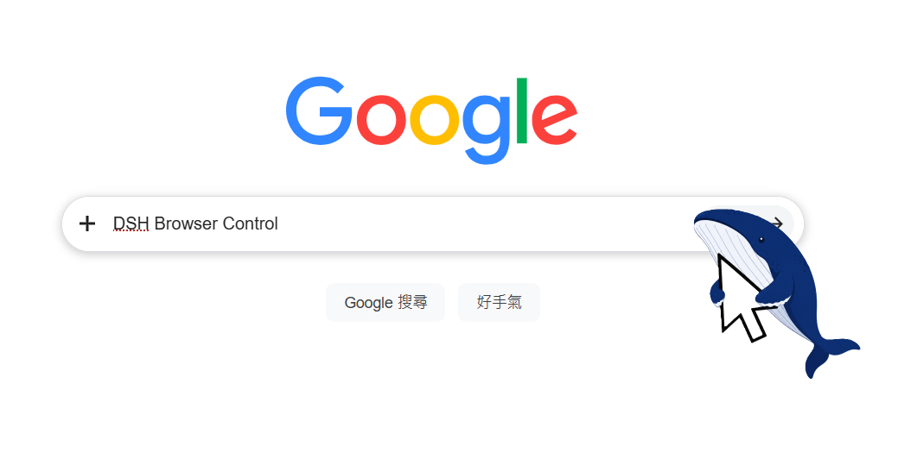

# DSH Browser Control

<p align="center">
  
</p>

<p align="center">
  <a href="README.md">简体中文</a> · <a href="README.en.md">English</a>
</p>

<p align="center">
  <a href="https://github.com/caob23/dsh-browser-control/releases"></a>
  <a href="https://github.com/caob23/dsh-browser-control/blob/main/LICENSE"></a>
  <a href="https://awesome-dsh-plugin.com"></a>
  <a href="https://developer.chrome.com/docs/extensions/develop/migrate/mv2-deprecation-timeline"></a>
  <a href="https://github.com/topics/dsh-plugin"></a>
  
  
  
</p>

A Chrome extension + DeepSeek Harness plugin that lets AI agents drive your real browser like a human.

<p align="center">
  
</p>

## What is this

Not a headless browser, not Puppeteer — your **real Chrome**, with your logins and cookies. The AI drives tabs through the Chrome DevTools Protocol while you watch every step on screen.

```
You say one sentence to the AI
      ↓
Agent calls browser_* tools
      ↓
DSH plugin (WebSocket bridge)
      ↓
Chrome extension (CDP)
      ↓
Your real browser performs the action
      ↓
Result returns to the Agent
```

## How it differs from MCP browser solutions

Browsers via MCP (Playwright MCP, Puppeteer MCP, browser-use…) share one trait: they launch a **fresh browser instance they downloaded themselves**. This project takes the other road:

| | This project | Playwright / Puppeteer MCP |
|---|---|---|
| Browser | The real Chrome you are using | Separate auto-downloaded instance |
| Logins / Cookies | ✅ Fully inherited, no re-login | ❌ Fresh profile every time |
| CAPTCHAs / QR login | Rarely hit — your sessions stay logged in | Frequently stuck at login walls |
| Visibility | Live on your screen, tabs the agent opens land in a `DSH` group, grab the mouse anytime | Headless or separate window |
| Environment deps | No Node / npx / Python needed | Needs npx or uvx runtime |
| Setup | Load extension + settings toggle | Edit MCP client JSON config |
| Disk usage | Reuses existing Chrome, zero extra | Downloads hundreds of MB |
| Integration depth | Native dsh plugin (status page / cleanup button; whether a settings card exists depends on the host version, see below) | Generic MCP server |

In one line: **for "use MY browser" tasks (logged-in Bilibili, Zhihu, admin panels), use this project; for generic cross-browser test automation, use MCP.**

## Download

| File | Purpose |
|---|---|
| [DSH-Browser-Control-v1.0.17.zip](https://github.com/caob23/dsh-browser-control/releases/download/v1.0.17/DSH-Browser-Control-v1.0.17.zip) | Chrome extension (unzip and load; standard zip header, Explorer can expand it directly) |
| [dsh-browser-control-plugin-v1.0.17.zip](https://github.com/caob23/dsh-browser-control/releases/download/v1.0.17/dsh-browser-control-plugin-v1.0.17.zip) | dsh plugin (offline fallback; online installs use Option A/B) |

## Install the Chrome extension (30 seconds)

Download the zip → unzip to a fixed folder (don't delete it) → open `chrome://extensions` → enable Developer mode → click "Load unpacked" → pick the unzipped folder.

Whale icon in the toolbar = success. Requires Chrome 116+.

## Install the dsh plugin

📦 This package is a bundle (`package.json` points `dsh.bundle.patch` at `cordis.patch.yml`). A successful `dsh plugin add` registers it under the profile's `dsh.profile.bundles`; a restart loads it.

Prerequisite: `dsh plugin` forwards to pnpm, so pnpm must be on PATH; the target profile is initialized automatically on first use.

### Option A: install from npm (recommended)

```bash
# Install from the npm registry and register it with the profile
dsh plugin --profile web add @caob23/dsh-browser-control
```

If you manage the profile's node_modules yourself, plain npm works there too:

```bash
npm install @caob23/dsh-browser-control
```

> **A version published minutes ago may not install yet, and that is not a broken package.** `dsh plugin add` pins the dependency to an **exact version**, while pnpm resolves it from **your configured registry** — for many users that is `registry.npmmirror.com`, which syncs from the official registry with a delay (measured: the official registry had 1.0.10 published while the mirror's `latest` still said 1.0.8). If you hit `ERR_PNPM_NO_MATCHING_VERSION ... while fetching it from https://registry.npmmirror.com/`, pick one:
>
> 1. Use the official registry for this install: `dsh plugin --profile web add @caob23/dsh-browser-control@<version> --registry=https://registry.npmjs.org/`
> 2. Use the offline asset from the Release, `dsh-browser-control-plugin-v<version>.zip`: unzip it, then `dsh plugin --profile web add file:<the unzipped directory>`
> 3. Wait for the mirror and retry: `curl -s https://registry.npmmirror.com/@caob23%2Fdsh-browser-control` — once the version appears there and `dist-tags.latest` moved, the plain command works
>
> **A second failure looks similar but has the opposite cause — do not touch your registry for it.** dsh profiles ship a 24-hour package-age supply-chain gate (`minimumReleaseAge: 1440` in `node_modules/.pnpm-workspace-state-v1.json`). A version younger than that is rejected with `ERR_PNPM_NO_MATURE_MATCHING_VERSION`, and the message quotes `was published at …, within the minimumReleaseAge cutoff (…)` — the version **does** exist, it is just too new. Waiting past the cutoff is the only fix. Discriminator: `NO_MATCHING_VERSION` = your registry does not have that version; `NO_MATURE_MATCHING_VERSION` = it has it, but the version is younger than 24h.

### Option B: install from GitHub or a local directory

```bash
# Straight from GitHub
dsh plugin --profile web add "github:caob23/dsh-browser-control#v1.0.17"

# Local checkout for debugging (note: the explicit file: prefix is required)
dsh plugin --profile web add "file:D:\path\to\dsh-browser-control"
```

Restart DSH to load it. Uninstall:

```bash
dsh plugin --profile web remove @caob23/dsh-browser-control
```

> ⚠️ Always use the `file:` prefix for local directories. Bare / relative paths
> are treated as the `link:` protocol by pnpm, which does not materialize into
> node_modules top-level under hoisted layouts and fails to resolve at boot.

After installing and restarting, the bridge is on by default (v1.0.6+); no manual enable step. The status page at http://127.0.0.1:9777/ confirms the listener is up.

> To opt out: in your profile override layer `$DSH_HOME/profiles/<name>/cordis.patch.yml`, write
> `- id: browser-bridge` with `config: { enabled: false }` (see [dsh-config/README.md](dsh-config/README.md)).
> Do not change the in-package `cordis.patch.yml` back to `enabled: false` — that value overrides the
> schema default and shows up as "nothing listens on 9777 after install" (issue #4).

### Option C: copy into the harness tree (legacy, v1.0.2 and earlier)

```bash
git clone https://github.com/caob23/dsh-browser-control.git
cd dsh-browser-control
git checkout v1.0.2   # legacy layout lives at the v1.0.2 tag
./install.sh /path/to/deepseek-harness
```

The script only copies plugin files into place — **you still need the three manual config edits**, then restart dsh:

Download [`dsh-browser-bridge-plugin-v1.0.2.zip`](https://github.com/caob23/dsh-browser-control/releases/download/v1.0.2/dsh-browser-bridge-plugin-v1.0.2.zip) and unzip into `deepseek-harness/packages/web/browser-bridge/`.

Then add three pieces of config:

1. In `packages/bundle/base/package.json` dependencies:

```json
"@deepseek-ai/dsh-browser-bridge": "workspace:^"
```

2. In `cordis.patch.yml` plugins list:

```yaml
- id: browser-bridge
  name: '@deepseek-ai/dsh-browser-bridge'
  config:
    enabled: false
```

3. In `tsconfig.host.json` references:

```json
{ "path": "./packages/web/browser-bridge" }
```

Restart dsh. Details in [dsh-config/README.md](dsh-config/README.md) (this path targets the pre-v1.0.3 layout, where `enabled: false` really was the default).

## Usage

1. It is already on after install (v1.0.6+); no manual enable step
2. The extension connects automatically (port 9777, default token dsh-local)
3. Talk in natural language; the agent drives the browser

### Whether a settings card exists depends on the host (issue #5)

The published bundle ships only the host-side `lib/index.js`; there is no browser-side module, so the card is not drawn by this plugin:

| Host | Settings page | How to change config |
|---|---|---|
| dsh 0.1.7+ / 0.2.x (dsh-settings 0.1.7-rc.2 onwards) | Yes — the host projects this plugin's own `Config` schema into a section | Settings page, or the profile override layer |
| dsh 0.1.2 and earlier | No entry (no client half claims the namespace, so nothing renders) | Profile override layer only: `$DSH_HOME/profiles/<name>/cordis.patch.yml` |

The config file works on both; see [dsh-config/README.md](dsh-config/README.md).

Visit `http://127.0.0.1:9777/` for connection status.

### Read-only mode and a separate script switch

In your profile overlay, on `browser-bridge`:

```yaml
config:
  readOnly: true      # reads only: click/input/press/nav/scroll/tabs/emulate/… are refused
  allowScript: false  # also turn off browser_evaluate (arbitrary JS in the page)
```

Refused commands are **never sent to the browser** (zero side effects), come back with
`blocked_by_policy`, and say which field to change. `readOnly` alone does **not** remove arbitrary
script execution — `browser_evaluate` can do everything the other tools can, which is why it is a
separate switch. These two govern the tool surface the model drives; the HTTP face (token-gated) is
your own channel and is unaffected.

### What agent tabs look like (automatic DSH group)

Tabs the agent **opens** are collected into a blue `DSH` tab group, one per window, so at a glance you can tell which pages a machine is driving and sweep them away afterwards:

- `browser_tabs` `action: "ungroup"` dissolves the group (pass `windowId` for one window, omit it for all) — it releases the grouping, it does not close the tabs.
- `browser_tabs` `action: "open"` with `group: false` keeps a new tab ungrouped; `action: "group"` pulls an already-existing loose tab in.
- Grouping is a nicety, never a prerequisite: on an old Chrome, without the `tabGroups` permission, or when Chrome's own tab bookkeeping wins the race, **opening the tab still succeeds** and the result carries `grouped: false` plus a reason. Grouping never changes page content, so retrying it is safe.
- `browser_tabs` `action: "close"` takes one tab (`tabId`) or a batch (`tabIds`), and a batch goes out as **one command**. The result accounts for every id — `closed` / `alreadyGone` (already gone = idempotent success, safe to retry) / `failed` (with the error) — so a partial failure is never swallowed, and single and batch share one shape.

### Calling the HTTP face from a script

`/api/command` and `/api/cleanup` now require the token — the same value the extension presents on the WebSocket:

```bash
curl -X POST http://127.0.0.1:9777/api/command \
  -H 'Authorization: Bearer <your token>' \
  -H 'Content-Type: application/json' \
  -d '{"command":"nav","params":{"url":"https://example.com"}}'
```

`?token=<your token>` and `X-Token: <your token>` work too. Missing or wrong token is a 401; `/` and `/api/status` stay unauthenticated read-only. What used to work without a token no longer does (issue #3 / #6). The cleanup button on the status page asks for the token once and keeps it in the browser session only.

## Tools

| Tool | Purpose |
|---|---|
| `browser_navigate` | Navigate to a URL |
| `browser_read` | Read page text/HTML — the text itself, in an `offset`/`limit` window |
| `browser_snapshot` | Page snapshot → the ref list itself (`mode:"ax"` reads Chrome's accessibility tree: role + accessible name) |
| `browser_click` | Click an element (by ref / selector) |
| `browser_type` | Type into inputs |
| `browser_press` | Send keyboard keys (Enter, Tab, arrows, and combinations like "Ctrl+A" / "Shift+ArrowRight"; one press inserts exactly once) |
| `browser_scroll` | Scroll the page |
| `browser_wait` | Wait for an element / text / page condition (up to 120s, v1.0.9+) |
| `browser_find` | Query elements by CSS selector, returning count and viewport rects (read-only, v1.0.9+) |
| `browser_dialog` | Read or set the native-dialog policy accept/dismiss/manual, plus the recent dialog log (v1.0.9+) |
| `browser_tabs` | Tab management (list/open/close/activate/group/ungroup; see "What agent tabs look like") |
| `browser_evaluate` | Run arbitrary JS |
| `browser_screenshot` | Capture page screenshot |
| `browser_console_log` | Captured console entries, listed with their text (v1.0.7+) |
| `browser_network_log` | Captured HTTP requests, listed with method/status/URL (v1.0.7+) |
| `browser_network_clear` | Clear the network log buffer on its own (v1.0.7+) |
| `browser_pdf` | Export the current page as PDF (v1.0.7+) |
| `browser_emulate` | Switch to a device viewport (mobile / desktop / custom, v1.0.7+) |
| `browser_cleanup` | Clean up temp files |
| `browser_info` | Which browser and extension build is attached (run it first when debugging, v1.0.9+) |

20 tools in total. `browser_wait`, `browser_find`, `browser_dialog` and `browser_info` existed inside the extension up to v1.0.8 but were never registered as tools, so the agent could not reach them; `browser_network_clear` existed in code and was simply missing from this table. `verify/verify_surface.mjs` now reconciles the extension command table, the commands the plugin calls, this table and the built bundle, so any drift fails `npm run verify`.

## Architecture

```
Chrome browser
  └─ DSH Browser Control extension (MV3)
       └─ chrome.debugger (CDP)
            └─ WebSocket ──────→ DSH plugin (browser-bridge)
                                      └─ browser_* tools → Agent
```

**Key design:**
- Extension dials out to the bridge (no native messaging host)
- Off by default; enabled manually from Settings
- Persistent debugger attachment — banner stays visible during control
- Listens on 127.0.0.1 only; the command surface (WebSocket and HTTP) shares one token, and no cross-origin access is granted
- The wire protocol has its own version, bumped only when the frame contract changes; a mismatch is named on the status page

## Verified

| Scenario | Result |
|---|---|
| Baidu search → extract result titles | ✅ |
| Bilibili user search → send DM | ✅ |
| Bilibili search → count video cards + screenshot | ✅ (real browser, 1.0.x era) |
| `npm run verify` harness: config resolution, three host shapes, HTTP auth and upgrade origin, published-bundle behaviour | ✅ 2026-10-10, see [verify/README.md](verify/README.md) |
| `verify_tab_groups` harness: group creation / reuse / backoff retry / stale cache / per-window dissolve / graceful degrade | ✅ 2026-10-11, node:vm plus a stateful fake `chrome.tabs`/`chrome.tabGroups` — **not re-run in a real Chrome** |
| `verify_extension_e2e` harness: real bridge + real extension code + real WebSocket end to end (frame contract, command reachability, error classification) | ✅ 2026-10-11 — only `chrome.*` is faked; visuals and real CDP behaviour still need a live browser |
| `verify_cdp_retry` harness: session recovery after Chrome steals the attach, replay must not re-run side effects, bounded retries (6 scenarios) | ✅ 2026-10-11, real `background.js` against a stateful fake `chrome.debugger`; cross-checked on a merge-preview build |
| `verify_render_contract` harness: every tool's real return value goes through the host's own output validator **and** its own `render`, asserting the model-facing text actually contains the data the call asked for | ✅ 2026-10-12, real bridge + fake extension + host `validateJsonSchemaValue`; this layer had **zero coverage** before, which is how two defect classes survived 12 / 5 released versions |
| **Real host × real browser**: local dsh `0.2.0-rc.2` mounted this plugin from an isolated `DSH_HOME`, the user's actual Chrome attached to the bridge, and 9 read-only tools ran through the real code path | ✅ 2026-10-12, Chrome 153 + extension 1.0.10: `browser_read` returned 1,341 chars of real page text, `browser_snapshot` returned 14 ref-bearing lines, zero output-schema violations; **this is also the run that exposed an older extension silently ignoring `mode:"ax"`** (local extension was 1.0.10, predating the 1.0.11 AX snapshot) — the plugin now reports `axFallback` explicitly |
| `tsc --noEmit` + `publint` | ✅ 2026-10-10 |

There have been no unit tests since v1.0.4 removed `tests/`; the three browser rows above are historical runs that were not repeated for this change, while every claim in this release comes from the repeatable harness under `verify/`.

## Changelog

See [CHANGELOG.md](CHANGELOG.md).

## License

This project is licensed under the **GNU Affero General Public License v3.0 (AGPL-3.0)**.

- **Personal / academic / non-commercial use**: completely free — use, modify, and distribute freely under AGPL-3.0 terms
- **Enterprise / commercial use**: AGPL-3.0 treats networked use as distribution, requiring derivative code to be published. If you want to embed this project in closed-source products or build a SaaS on it without open-sourcing, contact the author for a **commercial license** (terms negotiated separately)
- **Commercial licensing inquiries**: [GitHub Issues](https://github.com/caob23/dsh-browser-control/issues) or email **caob2333@outlook.com**

See the [LICENSE](LICENSE) file for the full license text (AGPL-3.0).
